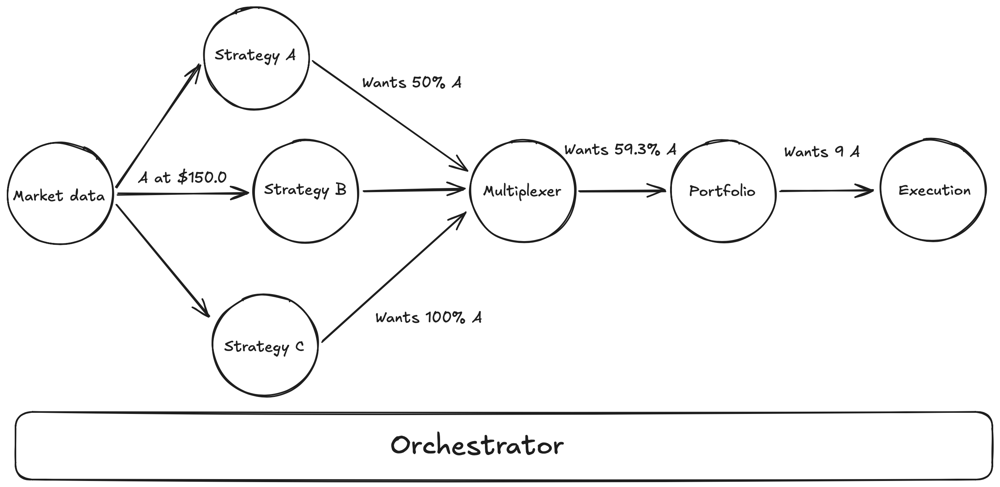
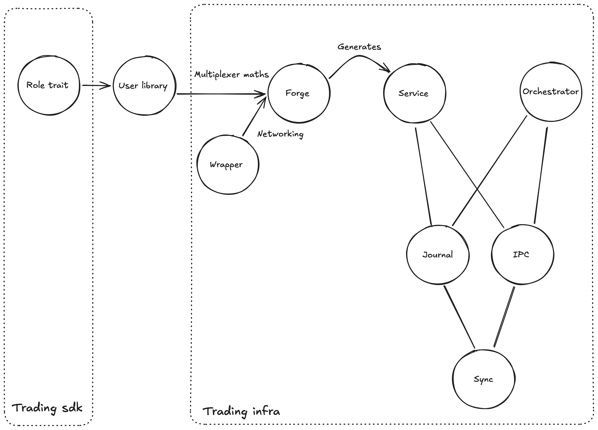

# Goal

The goal is to create a trading engine that would trade stocks on the american stock market. The priority when designing the trading engine was to provide very strong safety because the only way to trust my money with a machine is to have it do the right actions, even when some failure occures.

## Failures to be handled

I want at the end the software to handle the following catastrophic failures:
- host crash/shutdown: the host cannot be reached anymore
- server crash/shudown: the server on which the host is running cannot be reached anymore
- internet partition: the host cannot be reached anymore, however, it might still be running

## Overall trading infrastructure

Before going deep into the deployement or the system architecture, I want to make a small detour into the trading system itself, to understand its possible constraints and requirements.

Each steps in the trading system will be run isolated - that is on a separate process, that we will call **services**. This allows us to stop, start or swap a specific ***services** during live trading, without preventing the other modules to function properly.

The trading system will be separated into different type of services, with each their specific roles;
- data feed: it is responsible for quering data from the outside word.
- strategy: it takes the data that is provided as input from the data feed and provides a list of target positions - named `Allocation` in the source code.
- multiplexer: it takes several `Allocation` from different strategy and mix them to produce a unique consolidated `Allocation`.
- manager: it takes an `Allocation` and transforms the abstract weight in actual stock quantities and returns a `Target`.
- executer: it takes a `Target` and emits orders to have the `Actual` state reaching the `Target` state.
- broker: it takes the orders and transmit them to the actual broker through its API.

A simplified version of the workflow can be seen bellow.

# Architecture

The architecture is quite complex because of several factors, including but not limited to:
- the will to learn how to build such infrastructure from scratch - no use of kubernetes or distributed systems primitives ;
- strong safety requirements ;
- precise separation between infrastructure and trading maths ;
- careful attention putted into event recording and ledger.

The base of the architecture is the orchestrator. Its ultimate purpose will be to manage all the resources on a specific host. It is for now only responsible for port allocation and the launch of services. The second layer are the services, which performs the actual maths. Those two components relies on a few primitives to ensure tracability and speed:
- ipc: a tiny inter-process layer that is responsible for all interactions betweeen the processes.
- journal: an interface to record events during the lifecycle of a service. Its genericity allows for later unification of all logs and clean process of them.
- sync: a small synchronisation library that exposes several lock-free channels to communicate between network threads or journal threads.
- sync-lab: a friend of sync, this is a benchmarking binary.
- ledger: a specific service whose sole job will be to maintain a precise state of the currently own assets.
- modules: several default services available for deployement - including a data feed example and a kelly multiplexer. In the future, it will aslo include a default manager, a default executer and a default broker.
- forge: a tool that takes a library that implements one of the service type traits and buddle it in an executable. It removes from the strategy developer mainly the boilerpart for the networking, the journal and the orchestrator interactions.

## Inter process communication

The serivces communicates only in a specific patterns, and I disinged a specific ipc around it. Each communications with other services is of the following type:
- broadcast: the data sent through this interface will be delivered to several services - e.g. data feed.
- aggregate: the data received through this interface comes from several services - e.g. multiplexer.
- one-to-one: the data sent through this interface is delivered to exactly one service - e.g. multiplexer to manager.

For each type of interface can be either `Bind` or `Connect`, meaning that you are either the host of the transmission or the other end. The host role is the one described above for each part, and the client is the receiving end. For example, if the interface is `aggregate` `Bind`, it means that I am the host and therefore will receives data from several services through this interface.

For now, only `TCP` can be used as protocol.

Because each interface - called `Port` - can be of so many type and requires quite a lot of boilerpart, the IPC library provides a very tiny and simple interface with a macro to creates the designered interface with the other services.

We will now go layer by layer through the overall idea behind the implementation of the IPC layer.

## Fundation

The basic idea is that we want to be able to manage several ports at a time on the same network thread. So here we have two choices:
- either we figure at run time to what function should I redirect the calls ;
- or we figure it out statically ahead of time.

The first version not only incures recuring branching costs, which from my experiments do not dissapear with compiler optimizations, but it also leave more room for errors as the system would rely more on internal logic and less on the strong rust type system. The second option though requires much more infrastructure and is more difficult to design properly, but that is what we deicded to go for.

Now since we want to utilise the type system, the first thing one wants to do is to have one type per port implementation - called `Socket`. this way, we cannot possibly mistaken two different ports as the type would not allow it. However, to manage the pool of port, we need a common interface to be able to route properly the system wake signals to the different ports. To enable that, we provide the trait `NetworkEngine` that every `Socket` must implement.

However, a naive impementation is not optimal as it would involve `dyn` traits to manage the vector of ports. So we automatically derive the trait `EngineDispatcher` from any tupple of up to 7 ports automatically, which binds together the different ports.

With all of that done, there is still quite a lot of boilerpart to write to have the network thread running. We need to create all the different ports, alongside their socket access. We then need to bundle them together to create the thread. We also have to create a `Blueprint` that precisely describe the IPC interface used by the service. To avoid having a lot of copy paste, we expose the macro `make_ipc!` that bundle all of that in a very simple interface.